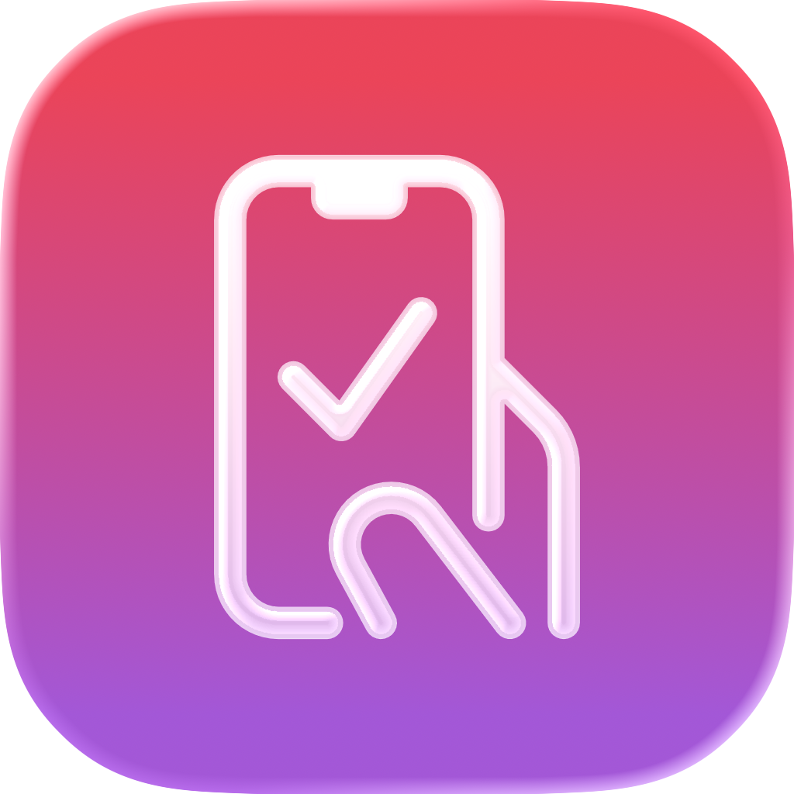
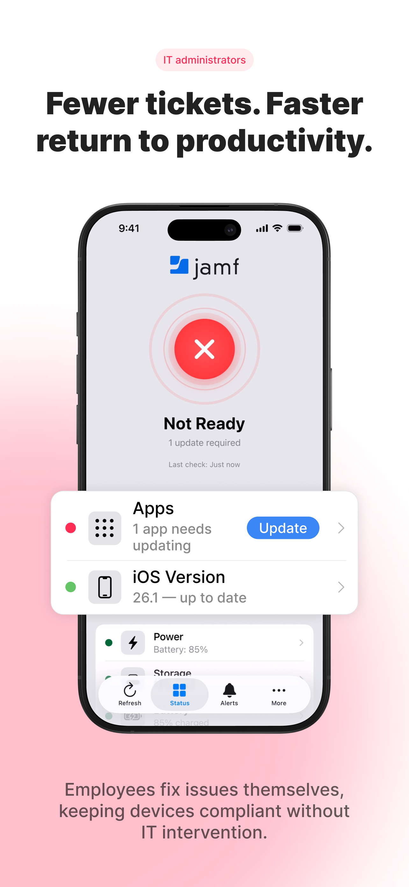
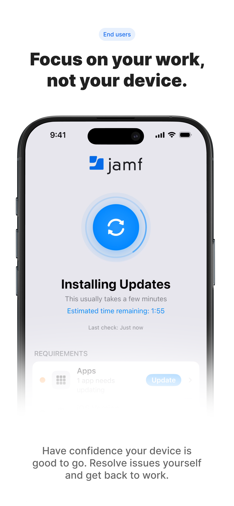
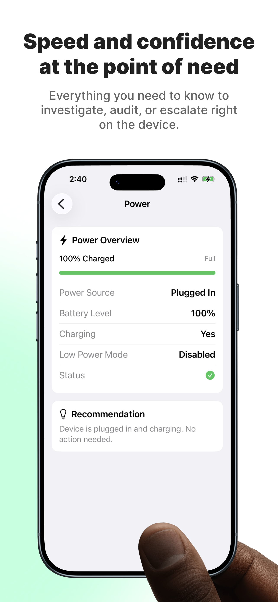
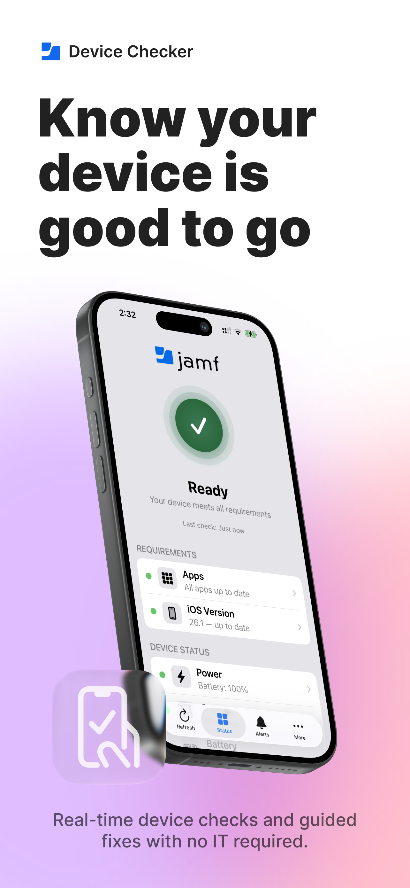
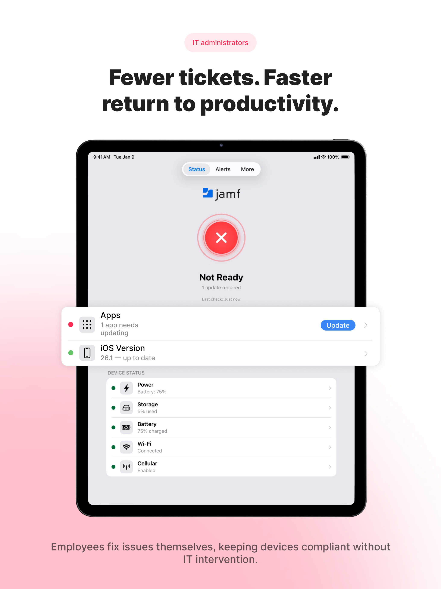
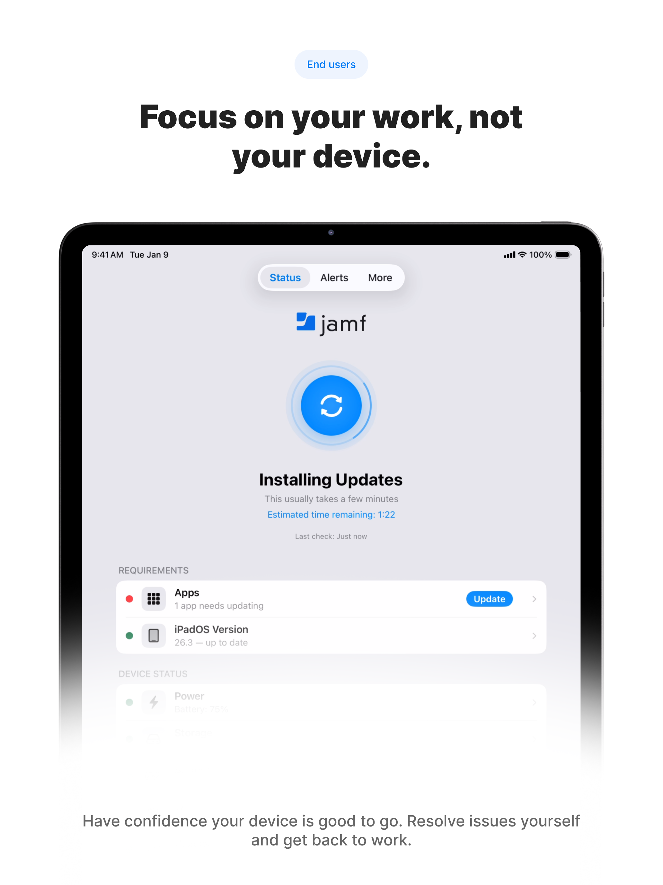
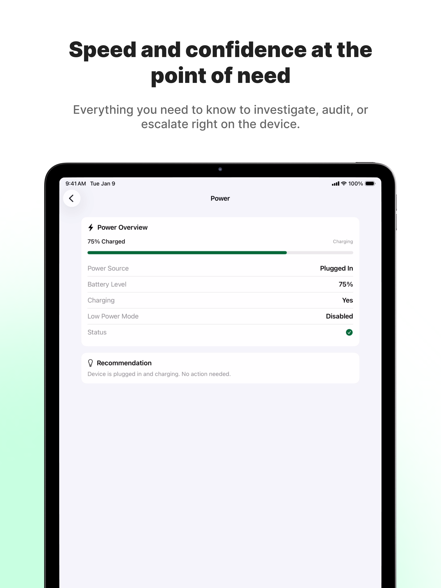
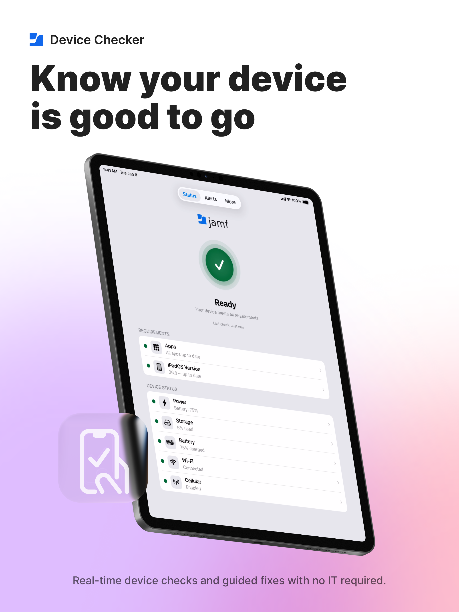

    
  

# Jamf Device Checker

> **This repository contains no source code.** It is an issue-tracking hub for the Jamf Device Checker app, available on the Apple App Store. Documentation lives on the [Jamf Concepts site](https://concepts.jamf.com/en/guides/jamf-for-mobile/jamf-device-checker/).

---

## Overview

### The Problem

When an employee shows up ready to work, the last thing they should be doing is troubleshooting their own device. But a dead battery, a pending OS update, a missing required app, or a flaky network connection can quietly derail productivity — and by the time IT hears about it, the workday has already been disrupted. End users rarely know where to look, admins have no easy way to give them a self-service view, and the back-and-forth of "is your device up to date?" wastes time on both sides.

### How Jamf Device Checker Solves It

Jamf Device Checker gives end users a single, at-a-glance dashboard that answers "is my device ready for work?" — no technical expertise required. Green, yellow, and red status tiles show OS version, required apps, battery health, storage, power, connectivity, thermal state, and performance, with clear guidance when something needs attention. Because the app is fully configured through Jamf Pro's Managed App Config, admins deploy it once and users get a self-service readiness check that reduces support tickets and keeps devices compliant.

---

## Screenshots

### iPhone

  
  
  
  

### iPad

  
  
  
  

---

## Documentation

Full documentation is available on the Jamf Concepts site:

- [Jamf Device Checker Guide](https://concepts.jamf.com/en/guides/jamf-for-mobile/jamf-device-checker/)

---

## Issues & Feedback

Use [GitHub Issues](../../issues) to submit bug reports, feature requests, or general questions.

- [Report a bug](../../issues/new?template=bug_report.yml)
- [Request a feature](../../issues/new?template=feature_request.yml)
- [Ask a question](../../issues/new?template=general_question.yml)

---

## About Jamf Concepts

Jamf Concepts is an innovation lab where Jamf employees collaborate to develop experimental tools, apps, and integrations that address emerging customer needs. These projects start with someone at Jamf who had the passion to build something for our customers and community — they aren't official Jamf products, though some eventually become part of the core offering.

Concepts take many forms: native Apple platform apps, web-based tools, utilities, integrations, and open-source projects. Many run in both test and production environments within the Jamf community.

You can get involved by trying concepts, contributing to open-source projects, or sharing feedback via GitHub issues.

Learn more at [concepts.jamf.com](https://concepts.jamf.com).

---

## License & Privacy

This app is available through the Apple App Store and is subject to the [Jamf Application End User License Agreement](https://www.jamf.com/resources/product-documentation/application-end-user-license-agreement/). This repository contains no source code, releases, or packages — no additional license file applies.

For information on how Jamf handles personal data, see the [Jamf Privacy Policy](https://www.jamf.com/privacy/).
